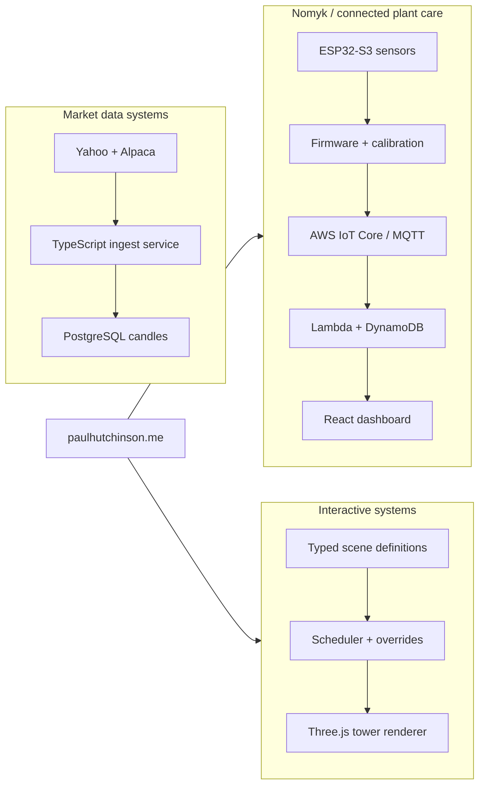

# Paul Hutchinson

Senior software engineer in Tokyo. I build production web systems, data pipelines, and hardware-backed product prototypes.

[paulhutchinson.me](https://paulhutchinson.me) - bilingual portfolio, current projects, career notes  
[nomyk.com](https://nomyk.com) - connected plant-care prototype  
[Lighting Lab](https://paulhutchinson.me/lighting-lab/) - interactive architectural-lighting demo

## Current Shape Of My Work

## Recent Projects

| Project | What it shows |
| --- | --- |
| [nomyk-device-core](https://github.com/pauldevnull/nomyk-device-core) | Public reference architecture for a connected plant-sensing device: sensor abstraction, calibration profiles, typed telemetry, LED state feedback, schemas, docs, tests, and safe public boundaries. |
| [market-ingest](https://github.com/pauldevnull/market-ingest) | Node.js + TypeScript service for OHLCV candle ingestion into PostgreSQL with provider adapters, full backfill, gap detection, idempotent writes, resume-on-restart, graceful shutdown, and Alpaca WebSocket support. |
| [Lighting Lab](https://paulhutchinson.me/lighting-lab/) | React + Three.js prototype for architectural lighting control: addressable fixtures, typed scenes, scheduled handoffs, manual mode, priority overrides, validation fallbacks, and brightness caps. |
| [paulhutchinson.me](https://paulhutchinson.me) | React 19 + TypeScript + Tailwind v4 portfolio, localized in English and Japanese, deployed to S3 behind CloudFront with a small deploy pipeline and CloudFront routing function. |

## Engineering Background

- 13+ years shipping production software across a small non-profit, an early-stage startup, and a pre-IPO public-company path.
- Full-stack product engineering: React, TypeScript, Node.js, Python, PostgreSQL, AWS, internal tools, workflow systems, and operational UI.
- Led and built systems handling 20k+ orders per week, configuration-heavy workflows, audit trails across services, and safer rollout paths.
- Comfortable close to the hardware: ESP32-S3 firmware, sensors, pump control, power design, MQTT telemetry, and cloud-connected device flows.
- I like systems that are easy to reason about, honest about tradeoffs, and polished enough that people can actually use them.

## What I Care About

- Clear boundaries between product logic, infrastructure, and presentation.
- Idempotent, observable backend work that can be restarted without drama.
- Interfaces that explain system state instead of hiding it.
- Documentation that captures decisions, not just setup commands.
- Learning in public through projects that cross software, hardware, and design.

## Elsewhere

- Portfolio: [paulhutchinson.me](https://paulhutchinson.me)
- GitHub contribution chart:

